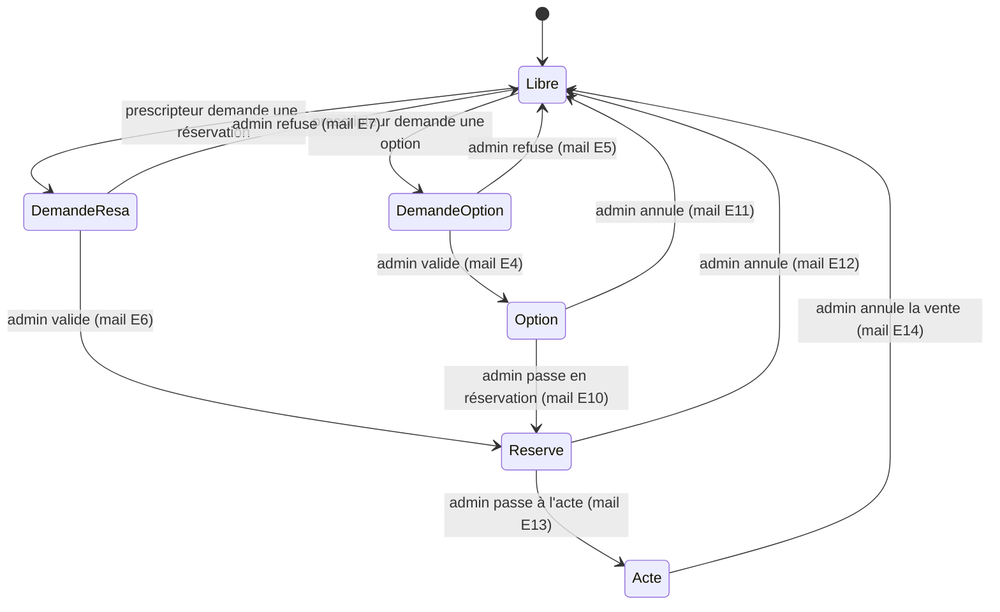

# Corim Vente : comprendre la plateforme en profondeur

Préparation du rendez-vous client du mardi 3 novembre 2026. État au 29 octobre 2026.

Sources : copie locale de la base de prod (dump du 27 octobre 2026), code de l'ancienne application (`OLD/`), contrats de la refonte (`NEW/docs/contract/`). Les douze derniers mois vont de novembre 2025 à octobre 2026.

## En une minute

Corim Vente sert surtout à **une seule chose : déclarer des acquéreurs (« dénonciations »)**.

- Sur les douze derniers mois, il y a eu 1 621 dénonciations : 1 227 validées et 394 refusées. Sur la même période, on compte 267 options et 77 réservations.
- L'activité monte : 1 057 dénonciations validées entre janvier et octobre 2026, contre 661 sur toute l'année 2025. Octobre 2026 est le mois record, avec 157.
- Le volume est très concentré :
  - **Programmes** : deux programmes font 72 % des dénonciations (COCOON 459, SCALA 424).
  - **Prescripteurs** : cinq prescripteurs en font 67 % (826 sur 1 227).
- Plusieurs modules ne servent plus du tout :
  - l'emailing (2 envois depuis 2013) ;
  - l'agenda (aucune ligne) ;
  - la fiche clients (212 fiches, toutes de 2012) ;
  - le flash info (3 actualités) ;
  - les demandes de documentation (rien depuis 2022).
- La messagerie interne ne transporte aucun message écrit par une personne. Sur douze mois, elle contient 1 996 notifications automatiques adressées à l'admin et zéro message humain.
- L'API publique alimente déjà deux sites Corim, `cocoon` et `corim-promotion`, à chaque affichage de page. C'est la base naturelle des « passerelles API » que la cliente demande.

Ce que les chiffres ne disent pas : le nombre de pages vues. Il faut les logs d'accès Apache de la prod, et je ne les ai pas récupérés (il faut ton accord pour aller sur le serveur).

## 1. Usage réel : ce qui est utilisé

### Volumes sur douze mois (novembre 2025 à octobre 2026)

| Fonctionnalité | Volume sur 12 mois | Commentaire |
|---|---|---|
| Dénonciations validées | 1 227 | cœur de l'usage, en forte hausse |
| Dénonciations refusées | 394 | 24 % des demandes traitées |
| Notifications internes (messagerie) | 1 996 | 100 % automatiques : 1 622 « dénonciation en attente », 360 « demande d'option », 14 « demande de réservation » |
| Options posées | 267 | |
| Réservations | 77 | |
| Ventes saisies dans la table `ventes` | 12 | voir la note sur les ventes plus bas |
| Emailing | 0 | 2 envois en tout, en 2013 et 2015 |
| Flash info | 0 | 3 actualités en base |
| Agenda | 0 | table vide |
| Fiches clients | 0 | 212 fiches, toutes de mars à août 2012 |
| Demandes de documentation via l'API (`docs`) | 0 | 2 104 en tout, la dernière en 2022 |

### Évolution sur plusieurs années

| Année | Dénonciations validées | Options | Réservations | Ventes (table) |
|---|---|---|---|---|
| 2016 | 806 | 205 | 72 | 172 |
| 2018 | 710 | 226 | 64 | 37 |
| 2020 | 445 | 174 | 26 | 18 |
| 2022 | 134 | 49 | 38 | 75 |
| 2023 | 123 | 28 | 26 | 71 |
| 2024 | 415 | 136 | 65 | 103 |
| 2025 | 661 | 164 | 28 | 28 |
| 2026 (jan. à oct.) | 1 057 | 240 | 69 | 7 |

Le creux de 2022-2023 et la reprise depuis 2024 suivent sans doute le lancement de nouveaux programmes : COCOON et SCALA sont les deux programmes actifs les plus dénoncés.

### Qui utilise la plateforme

- **Comptes** : 242 au total, dont 99 actifs et 143 désactivés.
- **Admin** : un seul compte (`privileges.acces = 1`, id 1). Corim, c'est donc une personne ou un compte partagé.
- **Prescripteurs actifs** : 50 ont fait au moins une dénonciation, une option ou une réservation sur douze mois. 45 ont dénoncé et 30 ont posé une option.
- **Concentration** : les cinq prescripteurs les plus actifs font respectivement 283, 202, 154, 103 et 84 dénonciations validées.
- **Rythme** : c'est une activité de bureau. Sur douze mois, chaque jour de semaine (lundi à vendredi) totalise environ 240 dénonciations, le samedi 59 et le dimanche 5.

### Le stock en ce moment

| Programme actif | Lots libres | En option | Réservés | Actés | Total |
|---|---|---|---|---|---|
| COCOON | 47 | 3 | 30 | 0 | 80 |
| NATURA | 1 | 2 | 2 | 29 | 34 |
| SCALA | 7 | 1 | 13 | 0 | 21 |
| CARRÉ VIAS | 1 | 0 | 0 | 19 | 20 |
| LUMAE | 4 | 0 | 8 | 0 | 12 |
| VIA DOMITIA | 8 | 0 | 1 | 0 | 9 |
| L ARCHIPEL | 0 | 0 | 1 | 2 | 3 |
| ST HILAIRE | 1 | 0 | 0 | 0 | 1 |

8 programmes sont actifs et 32 archivés. Au total : 1 018 lots actés, 149 libres, 55 réservés et 6 en option. Seuls les 149 lots libres des programmes actifs sortent dans l'API publique.

### Signaux à garder en tête

- **Ventes** : la table `ventes` compte 1 014 ventes actives, mais 12 seulement datent des douze derniers mois. Pourtant les programmes NATURA et CARRÉ VIAS ont 48 lots actés. Soit les actes sont saisis en masse à la livraison, soit ils sont suivis ailleurs. **À demander.**
- **Options** : aucune option n'expire. 34 options validées ont plus de trois mois et bloquent toujours leur lot.
- **Doublons** : 53 couples (nom de prospect, programme) ont été dénoncés par au moins deux prescripteurs différents. Rien dans le code ne détecte ni n'arbitre l'antériorité.
- **Droits par lot** : `acces_lot` compte 18 470 lignes pour 231 comptes. Gérer qui voit quel lot est un vrai travail pour l'admin.

## 2. Acteurs et droits

| Acteur | En base | Ce qu'il fait |
|---|---|---|
| Admin Corim | `privileges.acces = 1` (un seul compte) | Crée les programmes et les lots, ouvre les comptes, donne les droits, valide ou refuse chaque demande, passe à l'acte, annule, consulte le rapport |
| Prescripteur (agent, réseau, commercial) | `privileges.acces = 0` | Voit les programmes et lots qui lui sont ouverts, dénonce un acquéreur, demande une option ou une réservation, suit ses dossiers |
| Sites partenaires | aucun compte | Lisent l'API publique (stock disponible, plans PDF), sans authentification |

Deux tables règlent ce que voit un prescripteur :

- `acces` (829 lignes) : les programmes qu'il voit sur son tableau de bord.
- `acces_lot` (18 470 lignes) : les lots qu'il voit dans la grille d'un programme. Un programme ouvert sans aucun lot ouvert affiche une grille vide.

L'admin gère les deux depuis « Privilèges » (`gestion_privilege`) ou depuis la fiche d'un prescripteur.

Ce qui change avec la refonte : dans l'ancien code, ces droits n'étaient vérifiés qu'à l'affichage. N'importe qui pouvait appeler les actions `json/*` sans être connecté, y compris créer un compte administrateur. La nouvelle version vérifie la connexion, le rôle et les droits sur chaque action.

## 3. Le cycle de vie d'un lot et d'un acquéreur

Tout passe par des **demandes** que l'admin valide à la main. Chaque demande déclenche trois choses à la fois : une ligne dans une table « en attente » (`d_*`), un message interne (`mp`) adressé à l'admin et un mail à `contact@corim-promotion.com`. Chaque décision de l'admin envoie un mail au prescripteur.

### Ce qui se passe concrètement, étape par étape

| Étape | Qui | Ce qui change en base | Le lot (`appartements.statut`) | Mails |
|---|---|---|---|---|
| Demande d'option | prescripteur, ou l'admin pour lui | ligne dans `d_options` + `mp` à l'admin | `''` → `opt` tout de suite | E1 à Corim |
| Demande de réservation | prescripteur, ou l'admin pour lui | ligne dans `d_reservations` + `mp` | → `res` tout de suite | E2 à Corim |
| Validation d'une option ou d'une réservation | admin | déplacée vers `options` ou `reservations` (statut 1) | inchangé | E4 / E6 au prescripteur |
| Refus | admin | demande supprimée | redevient `''` | E5 / E7 |
| Option passée en réservation | admin | `options` → `reservations` | `opt` → `res` | E10 |
| Passage à l'acte | admin | ligne dans `ventes` | → `act` | E13 |
| Annulation (option, réservation, vente) | admin | statut 0 | redevient `''` | E11 / E12 / E14 |
| Modification d'une date | admin | date réécrite | inchangé | aucun |

Le lot passe en `opt` ou `res` **dès la demande**, avant toute validation. Il disparaît donc aussitôt de l'API publique et des grilles des autres prescripteurs : c'est le mécanisme qui empêche deux personnes de bloquer le même lot. La refonte le rend fiable même en cas de clics simultanés.

### La dénonciation

Une dénonciation ne porte pas sur un lot. Elle déclare qu'un prescripteur amène un acquéreur sur un **programme**, ce qui protège sa commission.

1. Le prescripteur saisit civilité, nom, prénom, code postal, ville, programme et message. La demande arrive dans `d_prospects`, avec un `mp` et le mail E3 à Corim.
2. L'admin valide : la ligne est copiée dans `prospects` et le mail E8 part. S'il refuse, elle est copiée dans `r_prospects` et le mail E9 part.
3. Les dénonciations validées se recherchent, se re-datent et se suppriment.

C'est le flux le plus utilisé de loin : 1 621 demandes en douze mois, soit environ 135 par mois que l'admin traite une par une.

### Le tableau de bord et le rapport

- **Accueil** : à gauche les vignettes des programmes visibles, à droite 7 compteurs (lots actés, demandes d'options, options, demandes de réservations, réservations, demandes de dénonciations, dénonciations). Le prescripteur ne voit que ses propres chiffres.
- **Rapport** (admin) : nombre de lots et somme des prix par statut et par programme.

## 4. Programmes et lots

- **Programme** (`projet`, 40 lignes) : titre, lieu, département, date de livraison, description, vignette.
  - Une clé `projet_titre_key` (le md5 du titre) nomme son dossier de fichiers `medias/programmes/{clé}/`.
  - Ce dossier contient cinq sous-dossiers : `thumb` (vignette 120 px), `diapo` (diaporama), `plans`, `documents`, `visuels`.
- **Lot** (`appartements`, 1 228 lignes) : numéro, type (T2, T3…), étage, surface, prix, options (terrasse, parking…), statut.
  - Le prix est stocké en texte avec des espaces (« 185 000 »). Les sites partenaires dépendent de ce format.
- **Plans** : un PDF par lot, `plans/plan-{numéro sans espaces}.pdf`. La page « ajouter les plans » signale les lots dont le plan manque.
- **Ajout en masse** : import d'un CSV de 17 colonnes séparées par `;`, sans en-tête, en Windows-1252. C'est l'export Excel classique.
- **Archivage** : un programme archivé sort de l'accueil admin et de l'API. Un prescripteur qui y a accès le voit encore, comme avant.

## 5. Clients, prospects et communication

- **Prospects** : ce sont les dénonciations décrites plus haut. C'est la donnée la plus volumineuse et la plus sensible pour le RGPD : 6 668 validées et 1 949 refusées, avec nom, code postal et ville.
- **Clients** (`clients`) : un fichier importé et exporté en CSV, abandonné depuis 2012.
- **Messagerie** : sur le papier, des échanges entre Corim et les prescripteurs. En pratique, c'est la boîte de notifications de l'admin.
- **Emailing** : un envoi groupé aux prescripteurs d'un programme. Il n'a quasiment jamais servi.
- **Flash info** : un bandeau d'actualités (3 en base).
- **Contact** : le formulaire « Contacter Corim » envoie un mail.
- **Agenda** : jamais utilisé.

## 6. L'API publique actuelle

| Appel | Renvoie | Qui l'utilise |
|---|---|---|
| `GET /index.php/firstsearch?action=nextjscorim` (+ `type`, `city`, `residence`, `minBudget`, `maxBudget`) | tableau JSON des lots libres des programmes actifs, triés par prix | site COCOON (`AppartmentSection.astro`), site corim-promotion (recherche, navigation, éléments fixes : appel sur presque chaque page) |
| `GET /medias/programmes/{clé}/plans/plan-{numéro}.pdf` | le plan du lot | les mêmes sites |
| `firstsearch` (par défaut, `light`, `withref`), `search` (`allnews`, `light`…) | JSONP avec des noms de fonctions fixes (`MyFirstCallback`…) | anciens widgets, `app.js` |
| `firstsearch?action=email` | enregistre une demande de documentation (`docs`) | plus utilisé depuis 2022 |

Caractéristiques à connaître avant de parler passerelles :

- **Accès** : en lecture seule, sans authentification, sans version d'API et sans pagination.
- **Format** : tous les champs sont du texte, et le prix contient des espaces.
- **Ce qui sort** : uniquement le stock libre. Rien sur les options, les réservations, les dénonciations ni les statuts.
- **Écriture** : aucune. Un partenaire ne peut ni dénoncer, ni poser une option, ni être prévenu d'un changement.
- **Compatibilité** : la refonte reproduit ces réponses octet pour octet (38 contrôles automatisés). Les deux sites ne verront aucune différence. Elle ajoute une limite de débit et des requêtes protégées contre l'injection SQL.

## 7. « Passerelles API » : ce que ça peut vouloir dire

La demande peut recouvrir plusieurs choses très différentes. Il faut savoir laquelle mardi.

| Hypothèse | Sens du flux | Exemple concret | Ce qu'il faut construire |
|---|---|---|---|
| A. Diffuser le stock sur des portails immobiliers | Corim → portails | annonces des lots libres sur les portails du neuf ou via un multidiffuseur | un flux d'export au format exigé par le portail ou le multidiffuseur (à confirmer avec eux), mis à jour automatiquement |
| B. Brancher les réseaux de prescripteurs | dans les deux sens | un réseau d'agences dénonce ou pose une option depuis son propre logiciel, et reçoit les validations | une API avec authentification par partenaire, des droits par programme, des écritures (dénonciation, option) et des notifications sortantes (webhooks) |
| C. Alimenter d'autres sites Corim ou de partenaires | Corim → sites | un nouveau site programme, comme COCOON aujourd'hui | une API de lecture propre et documentée (OpenAPI), versionnée, à côté de l'actuelle |
| D. Synchroniser un outil interne | dans les deux sens | CRM, logiciel de gestion promoteur ou de notaire, signature électronique des contrats de réservation | des échanges sur mesure avec l'outil, à définir avec son éditeur |

Ce que la refonte permet sans tout casser :

- **Deux API côte à côte** : l'API actuelle reste figée pour COCOON et corim-promotion. Une nouvelle API versionnée (`/api/v1/...`) s'ajoute à côté.
- **Briques Laravel** : jetons par partenaire, limite de débit, files d'attente pour les envois et les webhooks, documentation générée. Tout cela existe déjà dans Laravel, sans framework supplémentaire.
- **Webhooks** : le cycle de la section 3 est déjà centralisé dans le module workflow. Brancher un webhook sur « lot passé en option, en réservation ou à l'acte » ou sur « dénonciation validée » est simple.
- **Périmètre** : c'est une **nouvelle fonctionnalité**. La règle actuelle de la refonte est « même projet, rien de plus ». Il faut donc chiffrer ces passerelles comme une étape distincte, après la mise en production de la refonte, ou décider explicitement de les y intégrer.

## 8. Préparer mardi

### Pistes d'amélioration que les données suggèrent

1. **Accélérer les dénonciations.** Environ 135 par mois, chacune validée à la main par un seul admin. La page Dénonciations de l'admin charge aujourd'hui les 6 668 dénonciations d'un coup (4,8 Mo de HTML, 5 835 calendriers) : c'est la page la plus lente du site. Pistes :
    - pagination ou affichage par période (12 derniers mois par défaut, la recherche pour le reste) ;
    - détection automatique des doublons (même nom sur le même programme, 53 cas connus) avec la règle d'antériorité ;
    - validation groupée ;
    - délais de réponse affichés.
2. **Faire expirer les options.** Une durée de validité avec relance avant échéance libérerait les 34 options de plus de trois mois.
3. **Remplacer la messagerie par de vraies notifications.** Un résumé par mail ou une file « à traiter » sur le tableau de bord, puisque la messagerie ne sert qu'à ça.
4. **Faire le ménage dans les modules morts.** Emailing, agenda, fiches clients 2012, flash info : les supprimer, ou les relancer s'il y a un vrai besoin.
5. **Simplifier les droits.** Ouvrir un programme entier à un prescripteur en un clic, plutôt que lot par lot (18 470 lignes aujourd'hui).
6. **Suivre l'activité des prescripteurs.** Un tableau par prescripteur et par programme : dénonciations, taux de transformation en réservation. Cinq prescripteurs pèsent les deux tiers du volume.
7. **Mobile.** Une interface plus simple pour dénoncer depuis un téléphone. Le site actuel est en Bootstrap 3, mais peu pensé pour cet usage.
8. **RGPD.** Une durée de conservation et la purge des prospects anciens (plus de 8 600 personnes en base).

### Questions à poser à la cliente

- **Passerelles API**
  - Quels destinataires, nommément : portails, réseaux, logiciels ?
  - Dans quel sens circulent les données : lecture seule ou aussi écriture ?
  - Avez-vous un format imposé ou un multidiffuseur déjà sous contrat ?
  - Quel délai de mise à jour est acceptable : temps réel, horaire, quotidien ?
- **Ventes** : où sont suivis les actes ? La table `ventes` ne bouge presque plus alors que des lots passent à l'acte.
- **Options** : y a-t-il une règle de durée appliquée à la main aujourd'hui ?
- **Doublons de dénonciation** : comment sont-ils arbitrés aujourd'hui ?
- **Équipe** : combien de personnes utilisent le compte admin ? Faut-il plusieurs comptes Corim avec des droits différents ?
- **Modules** : lesquels peut-on retirer ? Emailing, agenda, fiches clients, flash info, messagerie.
- **Calendrier** : ces améliorations passent-elles avant ou après la mise en ligne de la refonte ?
- **Statistiques** : peut-on récupérer les logs d'accès du serveur ? Ils donneraient les pages vraiment consultées et le trafic réel de l'API.
